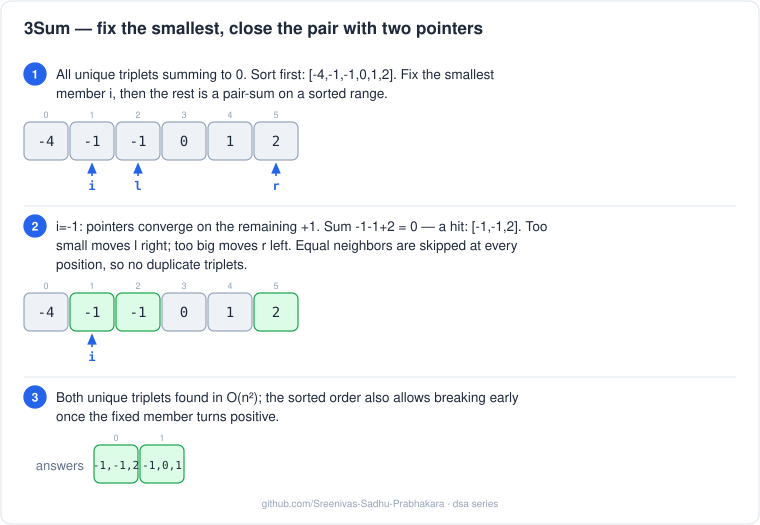

# 3Sum

> Striver SDE Sheet 039 · Day 7 LL & Arrays — sort, fix the smallest member, close each pair with converging pointers; duplicates skipped at every position. Go, stdlib only, tested.

## Problem

Find every unique triplet of values in an array summing to zero. Uniqueness is by values — `[0,0,0,0]` yields exactly one triplet.

## Approach

Sort, then for each candidate smallest member `a[i]`, the remaining task — find two values summing to `−a[i]` in a sorted suffix — is the two-pointer pair search: too small moves the left pointer, too big moves the right. Sortedness also powers the two pruning moves: once `a[i] > 0` no triplet can reach zero (break, not continue), and equal neighbors are skipped at all three positions so no duplicate triplet is ever emitted — cheaper than deduplicating through a set afterwards.

**Complexity:** O(n²) time, O(1) extra space beyond the output.

## Visual walkthrough

Read the picture top to bottom — each numbered frame is one moment of the algorithm
running on this repo's test example.

## Run

    go test ./...   # verify
    go run .        # demo

---

One of 191 repos solving Striver's SDE Sheet in Go — stdlib only, one problem per repo, every solution tested. Browse the set: [`dsa-*` repos](https://github.com/Sreenivas-Sadhu-Prabhakara?tab=repositories&q=dsa-&type=source).
